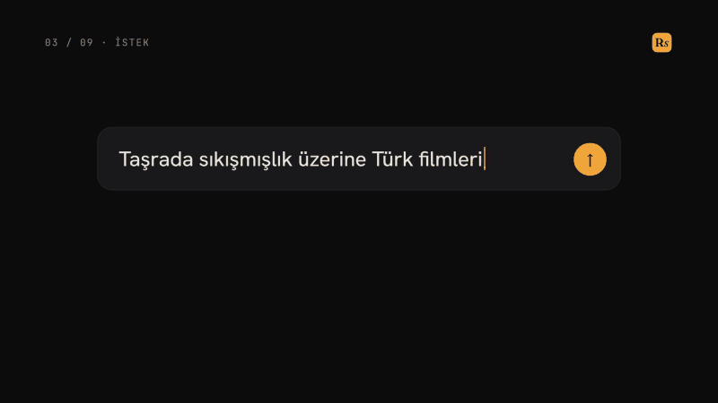
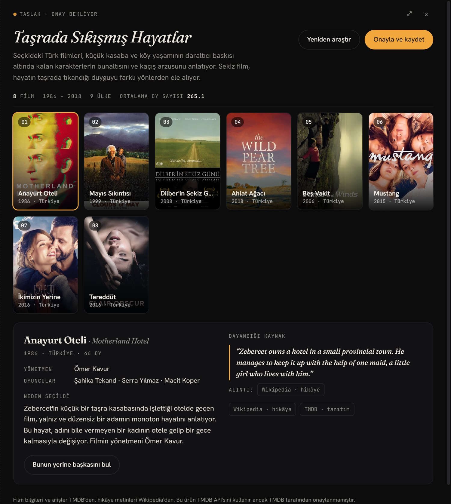
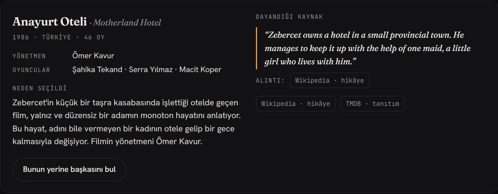
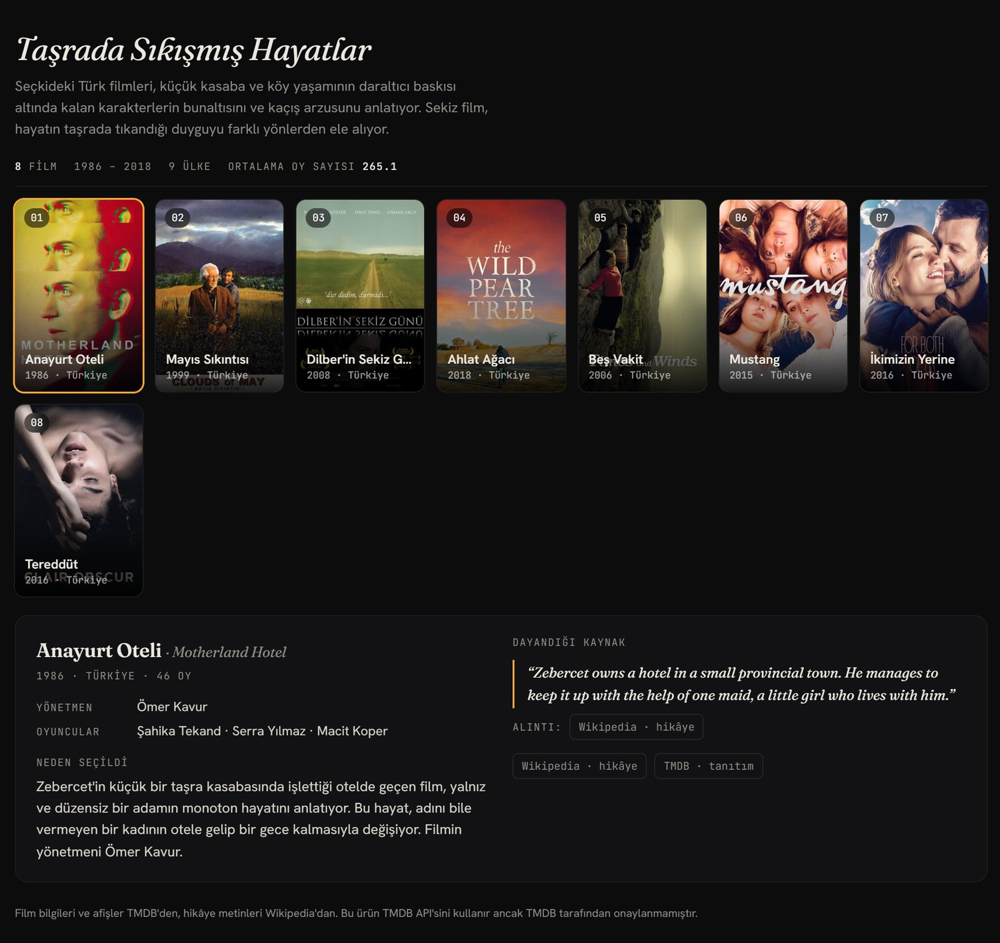
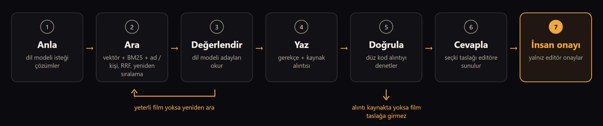
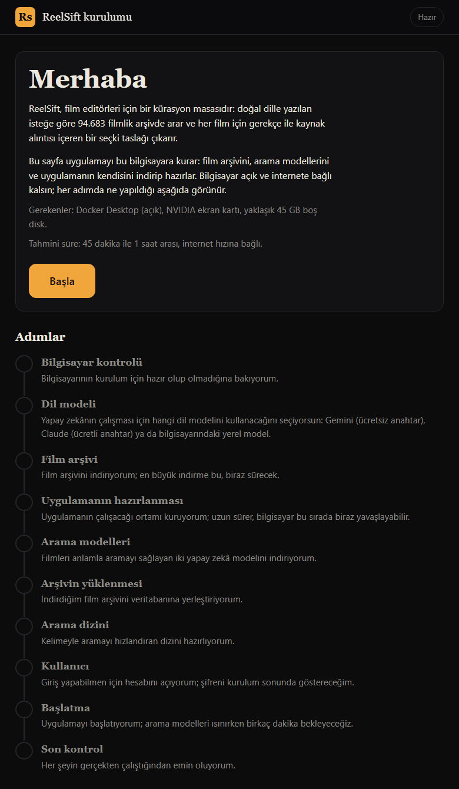
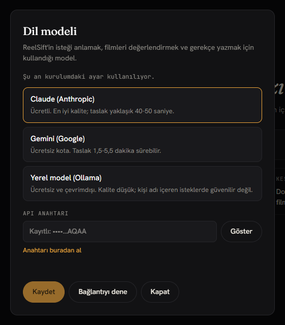

<p align="center">
  <picture>
    <source media="(prefers-color-scheme: dark)" srcset="sunum/marka/logo-yatay-koyu-zemin.svg">
    
  </picture>
</p>

<p align="center"><em>Her filmin bir gerekçesi, her gerekçenin bir kaynağı var.</em></p>

# ReelSift

BTK Akademi Yapay Zekâ Kariyer Atölyesi final projesi (Zeynep Şentürk).

ReelSift, film editörleri için bir kürasyon masasıdır. Editör doğal dille bir istek yazar ("Taşrada sıkışmışlık üzerine Türk filmleri"); sistem 94.683 filmlik arşivde arar, uygun filmleri seçer ve her film için gerekçe ile kaynak alıntısı içeren bir seçki taslağı çıkarır. Editör taslağı düzenler, onaylar ve paylaşır. Son söz her zaman editördedir.

<p align="center"><a href="sunum/tanitim/reelsift-nasil-calisir.mp4"></a></p>

<p align="center"><b>Tanıtım videosu (76 saniye):</b> <a href="sunum/tanitim/reelsift-nasil-calisir.mp4">ReelSift nasıl çalışır</a>. Ne sorunu çözdüğünü, bir isteğin hangi adımlardan geçtiğini ve ölçüm sonuçlarını anlatır.</p>

| Seçki taslağı | Film ayrıntısı | Paylaşım sayfası |
|---|---|---|
|  |  |  |

## Kısaca

| | |
|---|---|
| Veri | 94.683 film: TMDB bilgileri + Wikipedia hikâye metinleri (gerçek veri) |
| Yöntem | RAG: vektör araması + kelime araması + yeniden sıralama, LangGraph ile adım adım ajan akışı |
| Dil modeli | Üç seçenek: Claude Haiku 5.5, Google Gemini (ücretsiz anahtar), yerel model (Ollama); kurulumda seçilir, uygulama içinden Ayarlar ile değiştirilir |
| MCP | Arşiv ve arama hattı MCP sunucusuyla dış yapay zekâ asistanlarına açılır; ajan da bilgi sorularında bir MCP aracıyla kaynak getirir |
| Arama modelleri | Yerelde, ekran kartında: `BAAI/bge-m3` (embedding), `BAAI/bge-reranker-v2-m3` (yeniden sıralama) |
| Güvence | Alıntı kaynak metinde birebir geçmiyorsa film taslağa girmez (düz kod denetler); onayı yalnız insan verir |
| Yayın | Editörün onayladığı seçki tek tıkla herkese açık sitede yayınlanır: [livegundem.com](https://livegundem.com) |
| Ölçüm | 105 istekle uçtan uca ölçüldü; ayrıntı [`KALITE.md`](KALITE.md) |
| Testler | Backend 1052, arayüz 144 otomatik test |

## Nasıl çalışır

<p align="center"></p>

Bir istek şu adımlardan geçer:

1. **Anla** (dil modeli): istek konu, ülke, yıl, film sayısı gibi alanlara çözümlenir (yapılı çıktı).
2. **Ara** (arama motoru, dil modeli yok): anlam araması (vektör), kelime araması (BM25), film adı ve kişi araması birlikte çalışır; listeler RRF ile birleşir, bir yeniden sıralama modeli adayları isteğe uygunluğa göre dizer.
3. **Değerlendir** (dil modeli): en iyi adayların metinleri okunur, isteğe gerçekten uyanlar seçilir; yetmezse arama yinelenir (en çok 2 kez).
4. **Yaz** (dil modeli): seçilen her film için gerekçe ve kaynak metinden bir alıntı yazılır.
5. **Doğrula** (düz kod): alıntı kaynak metinde birebir geçmiyorsa film taslağa girmez.
6. **Cevapla** (dil modeli): taslak editöre sunulur. Seçkiyi **yalnız editör onaylar**: onay ayrı bir uçtadır ve ajan kodunun onay servisine erişemediği testle denetlenir.

Editör seçki istemek yerine bir bilgi sorusu sorarsa ("Zeki Demirkubuz kimdir?") istek ayrı bir koldan gider: ajan bir MCP aracıyla (`wikipedia_ozet`) kaynak getirir, cevabını o kaynağa dayandırır ve kaynağı cevabın sonuna ekler. Seçki hattındaki arama MCP üzerinden değil, doğrudan arama motoruna yapılır; aynı arama motoru MCP sunucusu olarak dış asistanlara da açıktır (ayrıntı aşağıda, "MCP").

Bu bir RAG (retrieval-augmented generation) sistemidir: önce arşivden bulunur, bulunan metinler dil modeline bağlam olarak verilir, model yalnız bu metinlere dayanarak yazar.

## Kullanılan teknolojiler

| Katman | Teknoloji |
|---|---|
| Veri | 94.683 film: TMDB bilgileri ve Wikipedia hikâye metinleri, PostgreSQL 18 |
| Vektör veritabanı | PostgreSQL + `pgvector` (kosinüs benzerliği) |
| Embedding modeli | `BAAI/bge-m3` (çok dilli; yerelde, ekran kartında) |
| Yeniden sıralama | `BAAI/bge-reranker-v2-m3` (yerelde) |
| Kelime araması | BM25 (`bm25s`) |
| Ajan akışı | LangGraph: 10 düğüm, yeniden arama döngüsü, sohbet durumunun PostgreSQL'e kaydı (checkpoint) |
| Dil modeli | Claude Haiku 5.5 (Anthropic API), Google Gemini ya da yerel model (Ollama) |
| Backend | Python 3.12, Django 5.2, Django Ninja, uvicorn |
| Arayüz | React 19, TypeScript, Vite, Tailwind CSS |
| Çalıştırma | Docker Compose (veritabanı, backend, arayüz) |

## Kurulum

### Gerekenler

- Windows 10 / 11, [Docker Desktop](https://www.docker.com/products/docker-desktop/) (açık ve "Engine running" durumunda), Git.
- NVIDIA ekran kartı (arama modelleri CUDA ile çalışır). Ekran kartsız çalışma ölçülmedi.
- Yaklaşık 45 GB boş disk (Docker imajları ~11 GB, veritabanı ~2,6 GB, arama modelleri ~4,6 GB, veri yedeği 1,7 GB, pay).
- Bir dil modeli seçeneği (aşağıdaki tablo).

### Dil modeli seçenekleri

| Seçenek | Gerekli olan | Ücret | Taslak süresi | Not |
|---|---|---|---|---|
| **Claude Haiku 5.5** | [Anthropic](https://console.anthropic.com/) API anahtarı | Ücretli (105 isteklik ölçümün tamamı 1,80 dolar tuttu) | Yaklaşık 40-50 sn | Ölçümlerin yapıldığı model; en iyi kalite |
| **Google Gemini** | [Google AI Studio](https://aistudio.google.com/apikey) anahtarı | Ücretsiz kota | 1,5-5,5 dk | Ücretsiz kotanın dakika sınırı yüzünden yavaş; Google'ın kabul etmediği film metni taslaktan düşer |
| **Yerel model (Ollama)** | [Ollama](https://ollama.com/download) + `qwen3:4b-instruct-2507-q4_K_M` (2,5 GB) | Ücretsiz, çevrimdışı | Yaklaşık 2,5 dk (tek ölçüm) | Kalite belirgin düşük ve kişi adı içeren isteklerde güvenilir değil (aşağıda "Yerel model denemesi"); 8 GB ekran kartı belleği sınırda |

### A. Kurulum sayfasıyla (önerilen)

```powershell
git clone https://github.com/zeyneepsenturkk/reelsift.git
cd reelsift
powershell.exe -NoProfile -ExecutionPolicy Bypass -File kurulum\sunucu.ps1
```

<p align="center"></p>

Tarayıcıda açılan kurulum sayfası (`http://localhost:5174`) adımları sırayla yürütür ve her adımda ne yaptığını söyler:

1. **Bilgisayar kontrolü:** Docker, disk, ekran kartı ve internet erişimi.
2. **Dil modeli:** üç seçenekten birini seçersin (Gemini, Claude ya da yerel model); anahtarın biçimi ve çalıştığı denetlenir, yerel modelde Ollama'nın açık olduğuna bakılır ve model yoksa indirilir. Seçim kökteki `.env` dosyasına yazılır.
3. **Film arşivi:** veritabanı yedeği bu deponun Releases sayfasından indirilir (1,7 GB) ve SHA-256 özeti doğrulanır.
4. **Uygulamanın hazırlanması:** Docker imajları kurulur (en uzun adım).
5. **Arama modelleri:** iki model Hugging Face'ten sabit sürümle indirilir (4,6 GB).
6. **Arşivin yüklenmesi** ve **arama dizini:** yedek veritabanına yüklenir, kelime araması dizini kurulur.
7. **Kullanıcı:** `editor` adlı hesap açılır; şifre kurulum sırasında rastgele üretilir ve kurulum sonunda ekranda gösterilir.
8. **Başlatma ve son kontrol:** uygulama açılır, arama modelleri ısınır (2-4 dakika), gerçek bir istekle çalıştığı denetlenir.

Yarıda kesilirse aynı komut kaldığı yerden sürer.

Kurulum bitince uygulama `http://localhost:5173` adresindedir. Bu yol 24 Kasım 2026'da bu deponun temiz bir klonuyla baştan sona denendi: 11 adımın 11'i hatasız, 35 dakika 37 saniye (RTX 4060, Docker önbelleği dolu; film arşivi Releases'ten girişsiz indi), ardından giriş, sağlık denetimi, bir taslak isteği ve MCP ucu doğrulandı. Adım adım süreler: [`kalite/kanit/kurulum-provasi-2026-11-24.md`](kalite/kanit/kurulum-provasi-2026-11-24.md). Toplam süre internet hızına göre 45 dakika ile 1 saat arasıdır (ölçüm: sıcak Docker önbelleğiyle yaklaşık 30 dakika).

### Yapay zekâ asistanıyla kurulum

Depoyu klonladıktan sonra klasörü bir yapay zekâ kodlama asistanında (Claude Code, Cursor, Codex vb.) açıp "kuruluma başlayalım" yazman yeterlidir. Kökteki [`AGENTS.md`](AGENTS.md) asistana kurulum sayfasını nasıl başlatacağını, ilerlemeyi nereden izleyeceğini, sık görülen sorunları ve dokunmaması gerekenleri (anahtarlar, veri silen komutlar) anlatır.

### B. Elle kurulum

Kurulum sayfasının çalıştırdığı komutların aynısıdır.

Komutlar PowerShell'de, depo kökünde çalıştırılır.

**1. Ortam dosyası.** `app\.env.example` dosyasını kök klasöre `.env` adıyla kopyala ve şunları doldur (gerisini boş bırak):

```
DJANGO_SECRET_KEY=<en az 50 karakter rastgele metin>
DJANGO_ALLOWED_HOSTS=localhost,127.0.0.1,backend
DJANGO_DB_NAME=reelsift
DJANGO_DB_USER=reelsift
DJANGO_DB_PASSWORD=<rastgele bir şifre>
```

`DATA_DIR` ve `MODELS_DIR` boş kalırsa kökteki `veri\` ve `modeller\` klasörleri kullanılır. Dil modeli için seçeneklerden birini ekle:

```
# Claude
LLM_PROVIDER=anthropic
ANTHROPIC_API_KEY=<anahtar>

# ya da Gemini
LLM_PROVIDER=gemini
GEMINI_API_KEY=<anahtar>
GEMINI_MODEL=gemini-3.5-flash-lite

# ya da yerel model (önce: ollama pull qwen3:4b-instruct-2507-q4_K_M)
LLM_PROVIDER=ollama
OLLAMA_BASE_URL=http://host.docker.internal:11434
OLLAMA_MODEL=qwen3:4b-instruct-2507-q4_K_M
OLLAMA_NUM_CTX=12288
```

**2. İmajlar ve arama modelleri.**

```powershell
mkdir veri, modeller
docker compose build
docker compose run --rm --no-deps -T -e HF_HUB_OFFLINE=0 -e HF_HUB_DISABLE_XET=1 -e SEARCH_WARMUP=0 -v "${PWD}\kurulum\adimlar:/kurulum:ro" backend python -I /kurulum/model_indir.py
```

**3. Film arşivi.** [Releases](https://github.com/zeyneepsenturkk/reelsift/releases/tag/veri-2026-11-18) sayfasından `reelsift-veri-2026-11-18.dump` dosyasını `veri\` klasörüne indir (SHA-256: `03507d1db605e3962c0ca9478d2b528918f0483ca51913edd24a376bc13aaef5`), sonra veritabanına yükle:

```powershell
docker compose up -d db
docker compose cp veri\reelsift-veri-2026-11-18.dump db:/tmp/reelsift-veri.dump
docker compose exec db sh -c 'pg_restore -U $POSTGRES_USER -d $POSTGRES_DB --no-owner --no-acl /tmp/reelsift-veri.dump'
docker compose run --rm -T -e SEARCH_WARMUP=0 backend python manage.py migrate --noinput
docker compose run --rm -T -e SEARCH_WARMUP=0 backend python manage.py build_search_index
```

`pg_restore` 10 dakika kadar sürer (arama indeksleri de kurulur); bazı uyarılarla sıfırdan farklı bir kodla bitebilir, veri yüklendiyse sorun değildir.

**4. Kullanıcı** (şifre en az 12 karakter):

```powershell
docker compose run --rm -T -e SEARCH_WARMUP=0 -e KURULUM_KULLANICI=editor -e KURULUM_SIFRE=<şifren> -v "${PWD}\kurulum\adimlar:/kurulum:ro" backend python manage.py shell -c "exec(open('/kurulum/kullanici.py').read())"
```

**5. Başlat.**

```powershell
docker compose up -d
docker compose logs -f backend   # "Arama hazır" satırını bekle (2-4 dakika)
```

Ekran kartı olmayan makinede `docker compose -f docker-compose.yml up -d` yalnız ana dosyayı kullanır; bu yol ölçülmedi.

### Çalıştığını nasıl anlarım

| Kontrol | Beklenen |
|---|---|
| `docker compose ps` | `db`, `backend`, `frontend` çalışıyor |
| `http://localhost:8000/api/health` | `200`, arama hazır |
| `docker compose logs backend` | "Arama hazır" satırı (açılıştan 2-4 dakika sonra) |
| `http://localhost:5173` | Giriş ekranı |

Sonraki açılışlarda yalnız `docker compose up -d` yeterlidir.

### Dil modelini sonradan değiştirme

Uygulamada sol alttaki kullanıcı menüsünden **Ayarlar**'ı aç: "Dil modeli" penceresinde Claude, Gemini ya da yerel modeli seç, gerekiyorsa API anahtarını gir ve **Bağlantıyı dene** ile çalıştığını gör. Değişiklik sunucuyu yeniden başlatmadan bir sonraki istekte geçerli olur.

<p align="center"></p>

- Anahtarlar veritabanında şifreli saklanır (Fernet; anahtar `DJANGO_SECRET_KEY`'den türetilir) ve hiçbir zaman ekrana, API cevabına ya da loglara geri yazılmaz; yalnız son dört karakteri ipucu olarak gösterilir.
- Kayıt yoksa kökteki `.env` dosyasındaki ayar kullanılır; arayüzden kaydedilen ayar onun üstüne yazar.
- Bu ekran tek kullanıcılı yerel kurulum için tasarlandı: oturum açmış her kullanıcı ayarı değiştirebilir.

## Ölçüm

Uçtan uca ölçüm: 105 gerçek istek, dil modeli döngüde (18 Kasım 2026, Claude Haiku 5.5, 105 turun 105'i hatasız bitti).

| Küme | Ne ölçüldü | Sonuç |
|---|---|---|
| Bilinen film (50 tarif) | Adı verilmeden tarif edilen film taslakta çıktı mı | %96 (48 / 50) |
| Konu (30 istek, Wikipedia listeleri) | Taslaktaki filmlerin konuya uygunluğu | %62, alt sınır: listede olmayan ama konuya uyan film yanlış sayılır |
| Ton (25 istek, MovieLens etiketleri) | Taslaktaki filmlerin tona uygunluğu | %49; 250 filmin yalnız 98'i yargılanabildi |
| Kaynak alıntısı | Alıntı kaynak metinde birebir var mı | %100 (tutmayan film taslağa zaten girmez) |

Arama hattı adım adım ölçülerek kuruldu. Aynı 50 tarifte ilk sırada bulma oranı:

| Adım | İlk sırada | İlk 10'da |
|---|---|---|
| Taban: film başına tek vektör, Türkçe sorgu | %8 | %16 |
| + hikâyeyi parçalara bölme, İngilizce sorgu | %16 | %36 |
| + kelime araması, çoklu sorgu, hayali hikâye, ad önerisi | %54 | %92 |
| + yeniden sıralama | %68 | %88 |
| + TMDB metinleri, film profili (uygulamanın varsayılanı) | %78 | %94 |

Bütün ölçümler, başarısız denemeler ve sınırlar [`KALITE.md`](KALITE.md) dosyasında; ham çıktılar `kalite/ham/` ve `kalite/kanit/` altında.

Ölçümün sınırları: tarifleri ve bir kısım uygunluk yargısını bir dil modeli yazdı; aynı 50 tarif hem hattı ayarlamada hem son ölçümde kullanıldı (ayrı tutulmuş test kümesi yok); uçtan uca ölçüm tek koşudur. Ton kümesi ise arama indeksinde bulunmayan bağımsız veriyle (MovieLens) ve güven aralığıyla ölçüldü. Gerekçe cümlesinin doğruluğu ölçülmüyor; yalnız alıntı kodla doğrulanıyor.

## Yerel model denemesi

Eğitmenin önerisiyle dil modeli adımları yerel bir modelle de denendi: Ollama, `qwen3:4b-instruct-2507-q4_K_M`, sıcaklık 0, bağlam 12.288 token, çıktı biçimi JSON şemasıyla zorlanmış (21 Kasım 2026, RTX 3080 dizüstü, 8 GB ekran kartı belleği).

| Adım | Yerel model (sn) | Claude Haiku (sn) | Biçim (JSON) | Kalite |
|---|---|---|---|---|
| Anla (4 istek) | 4,4-6,8 | 2,5-3,4 | 4 / 4 | Niyet ve filtreler aynı; 3 yeni isteğin 2'sinde uydurma film adı önerdi |
| Değerlendir (20 film) | 9,4-17,0 | 8,7-11,7 | 3 / 3 | Haiku ile aynı karar: 20 filmde 10-14; Haiku daha seçici |
| Seç | 4,6-5,2 | 2,2-5,9 | 3 / 3 | Öneriler Haiku'dan zayıf |
| Yaz (4 film) | 11,8-13,3 | 15,9-19,0 | 3 / 3 | Alıntı birebir: 12'de 11 (Haiku 12'de 12); Türkçe akıcı ama hatalı sözcükler var |

Ekran kartı belleği: arama modelleri yüklüyken 3,3 GB; yerel model de yüklenince 7,8 GB (8 GB'ın sınırında).

Sonuç: yerel model çalışıyor ve biçim kurallarına uyuyor, ama Türkçe kalitesi ve seçiciliği belirgin düşük. Bu yüzden varsayılan model Claude Haiku'dur; yerel model `LLM_PROVIDER=ollama` ile seçilebilen bir seçenek olarak eklendi. Ham ölçüm: [`kalite/kanit/yerel-model-2026-11-21.md`](kalite/kanit/yerel-model-2026-11-21.md).

Uygulama içi doğrulama (24 Kasım 2026, RTX 4060): yerel model sağlayıcısı gerçek Ollama ile denendi; yapılı çıktı çağrısı 11,0 sn (ilk çağrı, model yükleme dahil), akışlı cevap 1,1 sn sürdü ve ikisi de geçerli çıktı verdi ([`kalite/kanit/yerel-model-2026-11-24-uygulama.md`](kalite/kanit/yerel-model-2026-11-24-uygulama.md)).

Yerel modelle iki gerçek istek uçtan uca denendi (aynı gün, aynı makine; model ve arama modelleri birlikte 7,5-7,7 GB ekran kartı belleği kullandı, işlemciye taşma olmadı):

| İstek | Sonuç |
|---|---|
| "Taşrada sıkışmışlık üzerine 3 Türk filmi" | Tur baştan sona bitti: 146 sn'de 2 filmlik taslak. Üçüncü film, alıntısı kaynakta doğrulanamadığı için taslağa alınmadı (koruma çalıştı). Gerekçelerin Türkçesi akıcı, ama tema eşleşmesi zayıf. Sürenin çoğu değerlendirme adımında geçti (6 çağrı, 18-54 sn). |
| "Zeki Demirkubuz'un filmlerinden 3 film öner" | Çalışmadı (2 denemede 2): yerel model isteği "arşivde ara" diye çözümlemedi, arşive bakmadan kendi bilgisiyle cevap yazdı; taslak çıkmadı. |

Özetle yerel model seçeneği tematik isteklerde çalışıyor ama yavaş ve daha az isabetli; kişi adı içeren isteklerde güvenilir değil. Demo ve ölçümler için Claude Haiku önerilir.

Kurulum provasında (temiz kurulum, yerel model seçili) aynı tematik istek ilk denemede "model cevabı yarıda kesildi" hatasıyla düştü, ikinci denemede 70 saniyede 3 filmlik taslak çıkardı: yerel modelde bir isteği tekrar göndermek gerekebilir.

Bellek notu: 8 GB ekran kartında yerel model ile arama modelleri aynı belleği paylaşır. Uygulama açılırken arama modelleri ısınıyorsa (ilk 2-4 dakika) yerel modelin ilk çağrısı bellek yetmediği için "dil modeline ulaşılamıyor" hatası verebilir; ısınma bitince ("Arama hazır") tekrar denenince çalışır.

## MCP (Model Context Protocol)

ReelSift MCP'yi iki yönde kullanır.

### 1. Ajan bir MCP aracı kullanır: kaynaklı cevap

Editör taslak istemek yerine bir bilgi sorusu sorduğunda ("Zeki Demirkubuz kimdir?", "Film noir ne demek?") ajan cevabı kendi ezberinden yazmaz. Önce sorunun konusunu çıkarır, sonra MCP istemcisi üzerinden `wikipedia_ozet` aracını çağırır, cevabını dönen özete dayandırır ve kaynağı cevabın sonuna **kod** ekler (model değil):

```
Kaynak: Wikipedia, https://tr.wikipedia.org/wiki/Zeki_Demirkubuz
```

Araç sunucusu (`apps/agent/mcp_tools.py`) ve istemcisi (`apps/agent/services/mcp_client.py`) aynı süreçte çalışır ama aralarındaki konuşma gerçek MCP protokolüyledir (`initialize`, `call_tool`). Araç bir şey bulamazsa ya da zaman aşımına uğrarsa cevap eskisi gibi verilir; `ANSWER_SOURCES=0` ile kapatılabilir. Seçki / taslak yolu bu değişiklikten etkilenmez.

Gerçek denemede (Claude Haiku + Wikipedia) üç sorudan ikisinde kaynak bulundu ve cevap 2,9 saniyede geldi; "Merhaba, nasılsın?" sorusunda araç çağrılmadı. Sınır: Wikipedia özeti çok kısaysa cevap da kısa kalır; başlık aramasında en yakın sayfa alındığı için yanlış sayfa riski vardır.

### 2. Arşiv bir MCP sunucusuyla dışarıya açılır

Uygulama çalışırken `http://localhost:8000/mcp` adresinde bir MCP sunucusu da açıktır (taşıma: streamable HTTP). MCP destekleyen herhangi bir yapay zekâ asistanı buraya bağlanıp arayüzü açmadan 94.683 filmlik arşivde, ReelSift'in kendi arama hattıyla (vektör + BM25 + RRF + yeniden sıralama) arama yapabilir.

| Araç | Ne yapar |
|---|---|
| `film_ara(sorgu, adet, yil_en_az, yil_en_cok, ulke)` | Konuyu, temayı ya da atmosferi anlatan bir cümleyle arar; isteğe bağlı yıl ve ülke filtresi. En çok 25 film döner. |
| `film_getir(film_id)` | Tek filmin ayrıntısı: künye, özet, hikâye metninden bir bölüm, kaynak bağlantıları. |

Bağlamak için (örnek, Claude Code):

```
claude mcp add --transport http reelsift http://localhost:8000/mcp
```

Başka istemcilerde aynı adres "streamable HTTP" sunucusu olarak eklenir. Sonra asistana doğal dille sorulur: "ReelSift arşivinde rüyaların içine girip fikir yerleştiren bir ekibi anlatan film hangisi?"

Gerçek denemede (resmî MCP istemcisiyle) "Inception" tarifi filmi 1. sırada, 1960-1980 ve ABD filtresiyle "The Godfather" tarifi 4. sırada buldu (2,4 sn; arama modelleri soğukken ilk çağrı 31 sn); `film_getir` 0,05 sn.

Bilinmesi gerekenler:

- Sunucu yalnız okur: yalnız film tablosuna erişir; kullanıcı, sohbet, seçki ya da ayar verisine erişen araç yoktur.
- Kimlik doğrulama yoktur; uç yalnız bu makineden erişilecek biçimde açılır (`127.0.0.1`) ve yabancı `Host` / `Origin` başlıklı istekler reddedilir. Sunucuyu ağa açacaksan önüne kimlik doğrulama koy.
- Bu araçlar dil modeli çağırmaz; sorguyu çağıran asistan yazar. Arşiv metinleri İngilizce olduğu için İngilizce sorgu daha iyi sonuç verir.
- Arama modelleri ısınmadan gelen çağrı "arama hazırlanıyor" hatası döner. `MCP_ENABLED=0` ile kapatılır.

## Testler

```powershell
# Backend (her biri ayrı çalıştırılır)
docker compose run --rm -e SEARCH_WARMUP=0 backend python manage.py test
docker compose run --rm -e SEARCH_WARMUP=0 backend ruff check .
docker compose run --rm -e SEARCH_WARMUP=0 backend python manage.py check

# Arayüz
docker compose exec -T frontend npm run typecheck
docker compose exec -T frontend npm run test
docker compose exec -T frontend npm run build
```

Testler dil modelini ve aramayı sahte nesnelerle çalıştırır (gerçek anahtar gerekmez). Arama ve ajan kalitesi testlerle değil, yukarıdaki ölçümlerle sınanır (`evaluate_search`, `evaluate_agent` komutları).

## Klasörler

```
app/backend/     Django uygulaması
  apps/films       arşiv, vektörler, film profilleri
  apps/search      arama hattı (vektör, BM25, RRF, yeniden sıralama) ve ölçüm komutu
  apps/agent       LangGraph akışı, dil modeli katmanı (Claude, Gemini, Ollama) ve ayarı, MCP araçları, ölçüm komutu
  apps/curation    seçkiler, alıntı doğrulama, onay, paylaşım
  apps/chats       sohbetler
  apps/accounts    giriş
app/frontend/    React arayüzü
app/.env.example gereken ortam değişkenlerinin adları (değerler depoya girmez)
kurulum/         tarayıcıdan yürüyen kurulum sayfası ve adımları (Windows)
KALITE.md        ölçüm günlüğü; kalite/ altında ham çıktılar
docs/            arayüz ile backend arasındaki API sözleşmesi
sunum/           logo, ekran görüntüleri, kurulum sayfasının ortak stil ve yazı tipleri
```

## Bilinen sınırlar

- Arama modelleri NVIDIA ekran kartı ister; ekran kartsız çalışma ölçülmedi.
- Kurulum Windows için hazırlandı; başka işletim sisteminde yalnız elle kurulum yolu denenebilir (denenmedi).
- Taslak süresi Claude Haiku ile yaklaşık 40-50 saniyedir; Gemini'nin ücretsiz kotasıyla 1,5-5,5 dakika.
- Ton ve atmosfer isteklerinde kesinlik düşük (%49); en güçlü olduğu yer tarif edilen filmi bulmak ve dönem / ülke / kişi içeren isteklerdir.
- Türkçe özet arşivin bir bölümünde vardır; alıntılar çoğunlukla İngilizce kaynak metinden gelir.
- Kurs konularından n8n bu projede kullanılmadı; proje RAG, LangGraph, MCP ve yerel model başlıklarına odaklandı.
- Sürekli tümleştirme (CI) kurulu değil; testler elle çalıştırılır.
- `KALITE.md` içinde geçen `D:\reelsift-data\...` yolları geliştirme makinesindeki veri klasörüdür, depoda yoktur.

## Veri kaynakları

- Film bilgileri ve afişler [TMDB](https://www.themoviedb.org/)'den alınmıştır. Bu ürün TMDB API'sini kullanır ancak TMDB tarafından onaylanmamış ve sertifikalandırılmamıştır.
- Hikâye metinleri [Wikipedia](https://www.wikipedia.org/)'dan alınmıştır (CC BY-SA 4.0); başlangıç kümesi Hugging Face `NiklasAbraham/MoviePlotEmbeddingsDataset`.
- Ton ölçümünde MovieLens ml-25m Tag Genome yalnız yerelde, ölçüm için kullanıldı; depoya ve veri yedeğine dahil değildir.
- Film veritabanı yedeği (1,7 GB) bu deponun [Releases](https://github.com/zeyneepsenturkk/reelsift/releases) sayfasındadır (`veri-2026-11-18`); yalnız film tablolarını içerir, kullanıcı ya da sohbet verisi içermez.
- Yazı tipleri (Fraunces, Hanken Grotesk, JetBrains Mono) SIL Open Font License ile dağıtılır; lisans metinleri `sunum/ortak/yazi/` altındadır.
